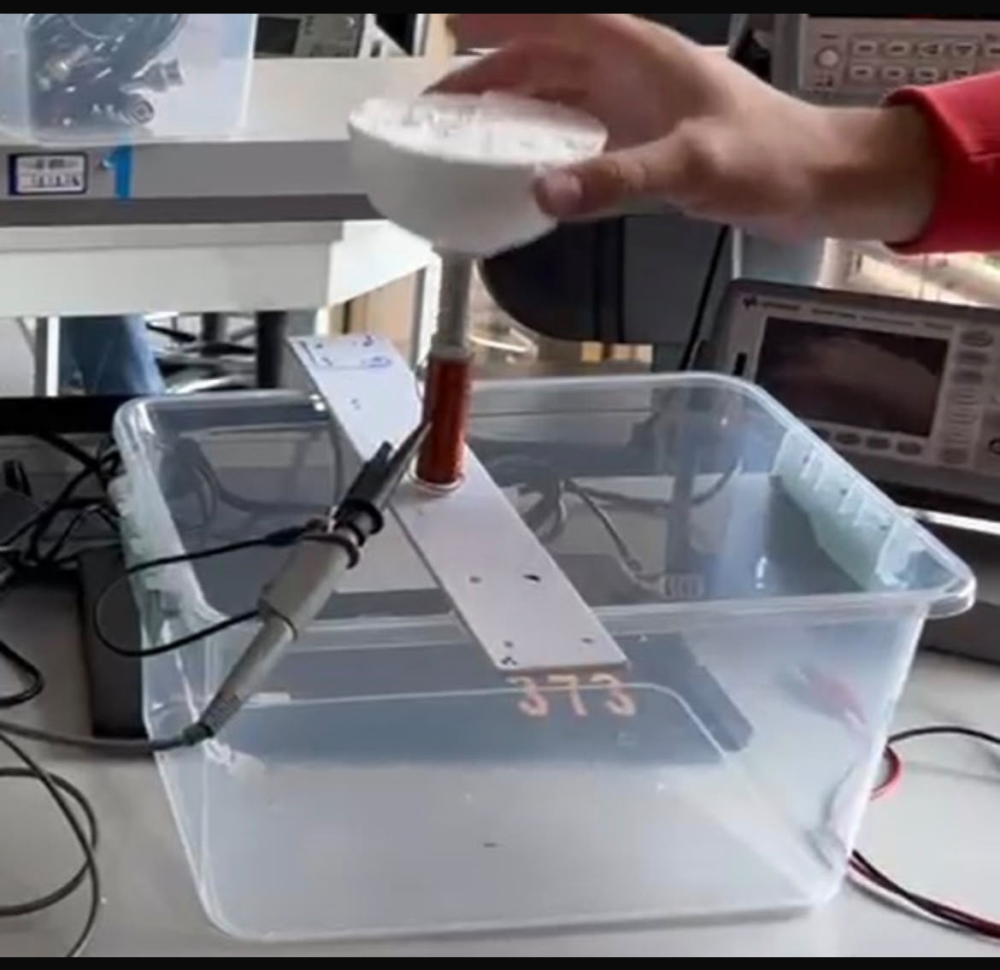

# Wave Energy Converter (WEC)
### Design, Development and Experimental Evaluation

## 1. Project Overview

This project focuses on the development and experimental evaluation of a wave energy conversion system designed to transform the vertical motion of waves into electrical energy.

The prototype uses a floating mechanism coupled to a moving permanent magnet assembly and a fixed electromagnetic coil, demonstrating the conversion of mechanical motion into electrical energy through electromagnetic induction.

## 2. Operating Principle

The system operates through the relative movement between permanent magnets and a fixed coil:

- The floating mechanism follows the vertical motion generated by the waves.
- The magnets move through the electromagnetic coil.
- The variation in magnetic flux induces an electrical voltage according to Faraday's law.
- The generated voltage is measured and analyzed experimentally.

## 3. Instrumentation and Experimental Validation

The experimental evaluation included:

- **Oscilloscope:** Keysight DSOX 2012A.
- **Sampling rate:** 100 kSa/s.
- **Motion analysis:** Tracker software.
- **Measurements:** Induced voltage, vertical position and float velocity.

## 4. Experimental Results

| Parameter | Measured value |
|---|---:|
| Peak-to-peak voltage | 0.11 V |
| RMS voltage | 0.032 V |
| Oscillation frequency | 0.35 Hz |
| Estimated power (100 Ω) | 0.0102 mW |
| Voltage repeatability | 12% |

The experimental results confirmed the expected relationship between magnet velocity and induced voltage.

## 5. Engineering Areas

- Renewable Energy Systems
- Electromagnetic Induction
- Mechanical Design
- Energy Conversion
- Experimental Instrumentation
- System Modeling and Analysis

## 6. Technical Documentation

[View the Experimental Report (PDF)](Generador_undomotriz.pdf)

## 7. Future Improvements

Potential improvements include increasing the coil winding count, optimizing magnetic coupling, introducing a ferromagnetic core, improving mechanical guidance and integrating power conditioning and energy storage electronics.

## 8. Authors

**Ana Sofia Barco Puentes**  
Mechatronics Engineering  
Pontificia Universidad Javeriana
