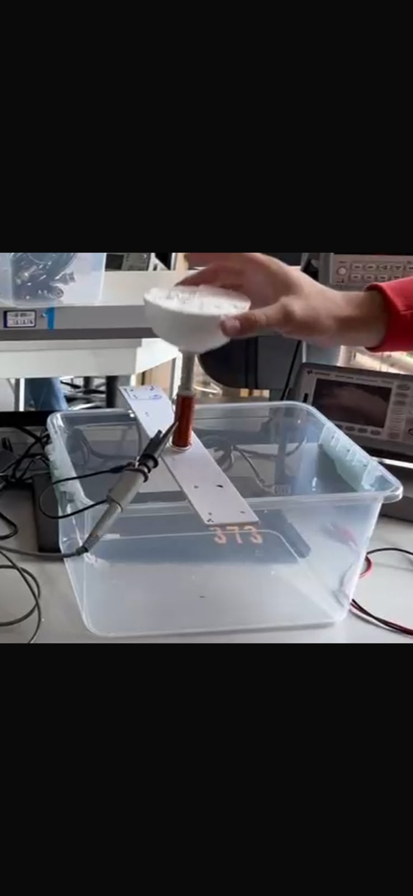

# Wave Energy Converter (WEC)
### Design, Development and Experimental Evaluation

## 1. Project Overview

This project involved the design, development and experimental evaluation of a wave energy conversion system. Its purpose is to transform the vertical motion of waves into electrical energy through electromagnetic induction.

The prototype combines a floating mechanism, a moving permanent magnet assembly and a fixed electromagnetic coil to generate an electrical voltage from mechanical motion.

## 2. Operating Principle

The system works through the relative movement between permanent magnets and an electromagnetic coil:

- The floating mechanism follows the vertical movement produced by the waves.
- The mechanical motion drives the magnet assembly.
- The magnets move relative to the fixed coil, producing a variation in magnetic flux.
- According to Faraday's law, this variation induces an electrical voltage.

## 3. Experimental Setup

The prototype was evaluated using a laboratory setup designed to reproduce vertical oscillatory motion.

The experimental work included:

- Measurement of the induced voltage using a Keysight DSOX 2012A oscilloscope.
- Analysis of the mechanical motion using Tracker software.
- Observation of the relationship between the movement of the floating mechanism and the electrical response.

## 4. Experimental Results

The following values were obtained during experimental evaluation:

| Parameter | Experimental value |
|---|---:|
| Peak-to-peak voltage | 0.11 V |
| RMS voltage | 0.032 V |
| Oscillation frequency | 0.35 Hz |

These measurements demonstrate the electrical response generated by the prototype under the tested operating conditions.

## 5. Engineering Areas and Technologies

- Renewable Energy Conversion
- Electromagnetic Induction
- Mechanical System Design
- Experimental Instrumentation
- Data Acquisition and Analysis

## 6. Technical Documentation

The complete methodology, theoretical development, experimental procedure and additional results are available in the technical report:

[Download the complete technical report (PDF)](Generador_undomotriz.pdf)

## 7. Project Demonstration

A video demonstration of the prototype will be included in this section.

## 8. Future Improvements

Potential improvements include optimizing the magnetic circuit, increasing electromagnetic coupling, improving the mechanical guidance system and integrating power conditioning and energy storage stages.

## Author

**Ana Sofia Barco Puentes**  
Mechatronics Engineering  
Pontificia Universidad Javeriana  
Bogotá, Colombia
